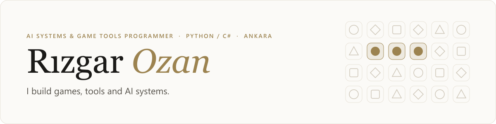
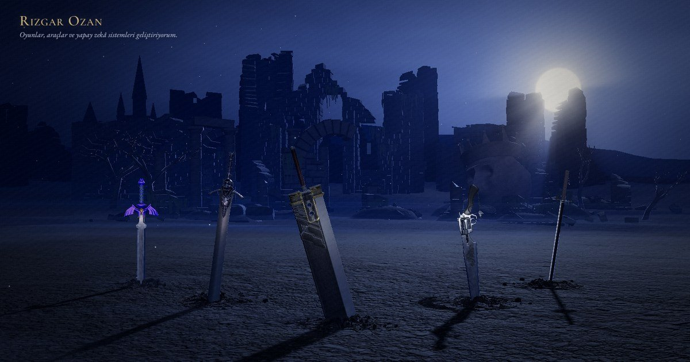
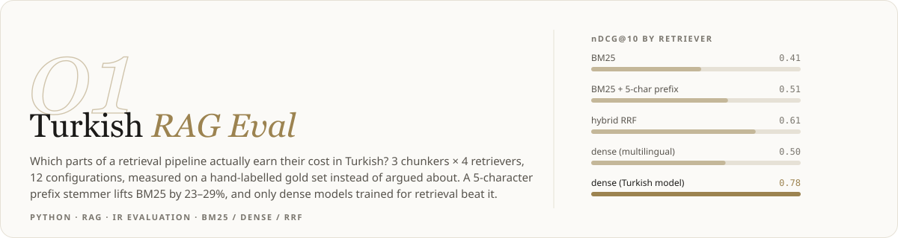
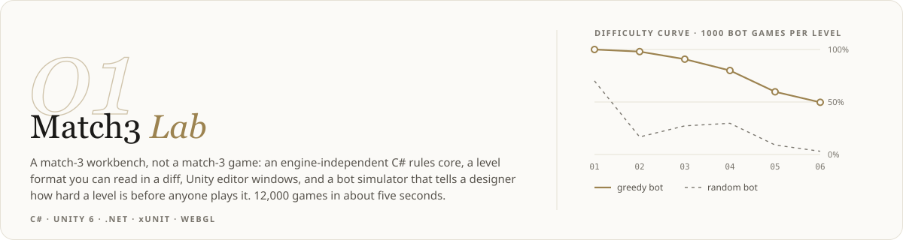
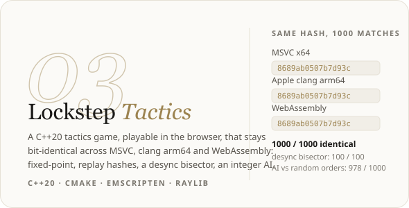
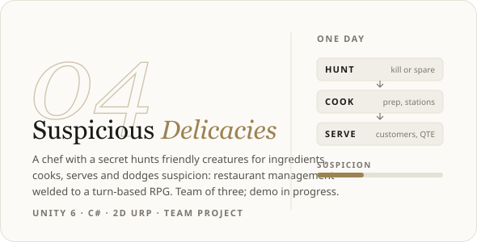
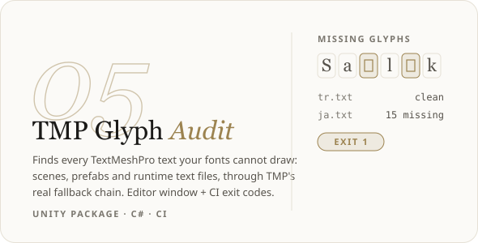
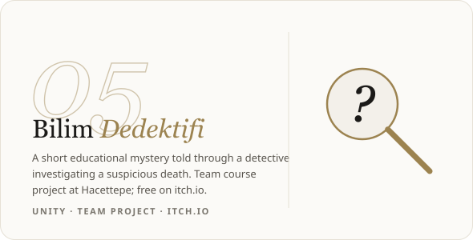
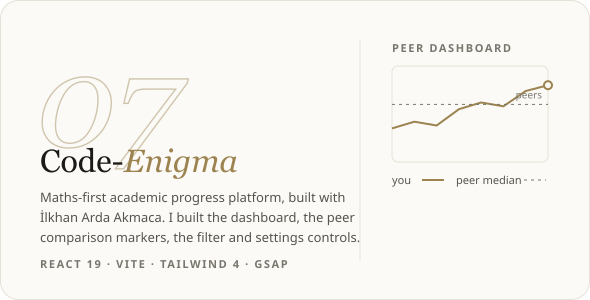

<picture>
  <source media="(prefers-color-scheme: dark)" srcset="assets/header-dark.svg">
  
</picture>

  <a href="https://rizgarozan.github.io">rizgarozan.github.io</a> · <a href="https://www.linkedin.com/in/rizgarozan/">LinkedIn</a> · <a href="https://rizgarozan.itch.io">itch.io</a> · <a href="https://huggingface.co/RizgarOzan">Hugging Face</a> · <a href="mailto:rizgarozan7@gmail.com">rizgarozan7@gmail.com</a>

I build games, tools and AI systems: retrieval evaluations that say which part of a RAG pipeline
earns its cost, and game tools that score a level or catch a broken font before anyone ships it.
Final-year Computer Education & Instructional Technology student at Hacettepe University, Ankara.

<!-- summary:start -->
**113 pull requests merged** into 36 projects I don't own — mteb, kornia, unity-mcp and docling among them — with 27 more in review.
<!-- summary:end -->

## Selected work

<a href="https://github.com/RizgarOzan/turkish-rag-eval">
<picture>
  <source media="(prefers-color-scheme: dark)" srcset="assets/card-turkish-rag-eval-dark.svg">
  
</picture>
</a>

<table>
<tr>
<td width="50%" valign="top">
<a href="https://github.com/RizgarOzan/match3-lab">
<picture>
  <source media="(prefers-color-scheme: dark)" srcset="assets/card-match3-lab-dark.svg">
  
</picture>
</a>
</td>
<td width="50%" valign="top">
<a href="https://github.com/RizgarOzan/lockstep-tactics">
<picture>
  <source media="(prefers-color-scheme: dark)" srcset="assets/card-lockstep-tactics-dark.svg">
  
</picture>
</a>
</td>
</tr>
<tr>
<td width="50%" valign="top">
<a href="https://rizgarozan.github.io/#suspicious-delicacies">
<picture>
  <source media="(prefers-color-scheme: dark)" srcset="assets/card-suspicious-delicacies-dark.svg">
  
</picture>
</a>
</td>
<td width="50%" valign="top">
<a href="https://github.com/RizgarOzan/tmp-glyph-audit">
<picture>
  <source media="(prefers-color-scheme: dark)" srcset="assets/card-tmp-glyph-audit-dark.svg">
  
</picture>
</a>
</td>
</tr>
<tr>
<td width="50%" valign="top">
<a href="https://rizgarozan.itch.io/bilim-dedektifi">
<picture>
  <source media="(prefers-color-scheme: dark)" srcset="assets/card-bilim-dedektifi-dark.svg">
  
</picture>
</a>
</td>
<td width="50%" valign="top">
<a href="https://github.com/ilkhanarda/Code-Enigma">
<picture>
  <source media="(prefers-color-scheme: dark)" srcset="assets/card-code-enigma-dark.svg">
  
</picture>
</a>
</td>
</tr>
</table>

## Open source

Fixes sent back to the retrieval and Unity tooling I use, refreshed daily by [a workflow](.github/workflows/profile.yml).

<!-- oss:start -->
| | Pull request | Project |
|---|---|---|
| 🟣 merged | [fix(asciidoc): keep a table whole across blank and wrapped lines](https://github.com/docling-project/docling/pull/4761) | [docling-project/docling](https://github.com/docling-project/docling) · ★ 68.8k |
| 🟣 merged | [fix(geometry): accept empty batches in spatial_softmax2d and spatial_expectation2d](https://github.com/kornia/kornia/pull/5739) | [kornia/kornia](https://github.com/kornia/kornia) · ★ 11.4k |
| 🟣 merged | [fix: keep the benchmark in BenchmarkResults.join_revisions](https://github.com/embeddings-benchmark/mteb/pull/5633) | [embeddings-benchmark/mteb](https://github.com/embeddings-benchmark/mteb) · ★ 3.5k |
| 🟣 merged | [fix(augmentation): make auto policies picklable](https://github.com/kornia/kornia/pull/5651) | [kornia/kornia](https://github.com/kornia/kornia) · ★ 11.4k |
| 🟣 merged | [[fix] Warn about every include_positives option that discards the positives](https://github.com/huggingface/sentence-transformers/pull/4053) | [huggingface/sentence-transformers](https://github.com/huggingface/sentence-transformers) · ★ 19.2k |

…and 108 more merged pull requests. Merges by project: mteb 19 · kornia 17 · unity-mcp 8 · docling 7 · browser-compat-data 5 · telegram-mcp 4 · results 4 · LightRAG 4 · module-replacements 3 · sentence-transformers 3, and 26 more projects.
<!-- oss:end -->

## Now · October 2026

- Turkish RAG Eval 0.2.0 is on [PyPI](https://pypi.org/project/turkish-rag-eval/): 300 queries (58 hand-labelled, 242 LLM-drafted and double-labelled) across five models, with the dataset on Hugging Face. The MTEB task is in review ([mteb#5615](https://github.com/embeddings-benchmark/mteb/pull/5615)), and the drafted queries are open for human review as good first issues.
- [Lockstep Tactics](https://github.com/RizgarOzan/lockstep-tactics) is playable: a C++20 tactics game checked on every push to be bit-identical between MSVC x64, Apple clang arm64 and WebAssembly, with an integer-only AI that wins 978 of 1,000 matches against random orders. [Play it in the browser](https://rizgarozan.github.io/lockstep-tactics/); a saved match verifies tick by tick on any machine. Next: two browsers exchanging commands over a relay.
- Graduating in June 2027; open to internships and new-grad roles in applied AI and game engineering.
