Final-year student at Hacettepe University, graduating in June 2027. I build games in Unity and C# and work on AI tooling. Looking for internships and new-grad roles in Europe and Turkey.

<!-- summary:start -->
**159 pull requests merged** into 41 projects I don't own, among them mteb, kornia, unity-mcp and docling. 16 more in review.
<!-- summary:end -->

**19 LeetCode solutions** in Python and C#: [leetcode-solutions](https://github.com/RizgarOzan/leetcode-solutions)

**Projects**

- [Turkish RAG Eval](https://github.com/RizgarOzan/turkish-rag-eval): a Turkish retrieval benchmark, on PyPI and now an MTEB task
- [Lockstep Tactics](https://github.com/RizgarOzan/lockstep-tactics): C++20 tactics game that stays bit-identical on MSVC, clang and WebAssembly ([play it](https://rizgarozan.github.io/lockstep-tactics/))
- [TMP Glyph Audit](https://github.com/RizgarOzan/tmp-glyph-audit): Unity package that finds TextMeshPro text your fonts can't draw
- [Match3 Lab](https://github.com/RizgarOzan/match3-lab): C# match-3 rules core, Unity editor tools and a bot simulator

## Duel: Soundwave vs Shockwave

Everyone who visits plays Soundwave in the same duel. Pick a move: Shockwave's AI answers and the scene below is redrawn. If the picture looks unchanged, give it a few seconds and refresh.

<!-- boss:start -->
**Round 1** · Soundwave 3000/3000 HP, 40 EP · Shockwave 3750/3750. Pick Soundwave's move ↓

| Move | Cost | Effect |
|---|---|---|
| [**ATTACK**](https://github.com/RizgarOzan/RizgarOzan/issues/new?title=boss%3A%20soundwave%20atk&body=Just%20press%20Submit.%20A%20GitHub%20Action%20plays%20the%20move%20and%20updates%20the%20README%20in%20about%20a%20minute.) | – | SONIC BLASTER: hit for 200–260 |
| [**LASERBEAK**](https://github.com/RizgarOzan/RizgarOzan/issues/new?title=boss%3A%20soundwave%20skill1&body=Just%20press%20Submit.%20A%20GitHub%20Action%20plays%20the%20move%20and%20updates%20the%20README%20in%20about%20a%20minute.) | 14 EP | Hit twice for 110–140 each |
| [**MIND SCAN**](https://github.com/RizgarOzan/RizgarOzan/issues/new?title=boss%3A%20soundwave%20skill2&body=Just%20press%20Submit.%20A%20GitHub%20Action%20plays%20the%20move%20and%20updates%20the%20README%20in%20about%20a%20minute.) | 8 EP | Hit for 90–120, take half damage this round (even from CRUSHING GRIP), and see Shockwave's plan and reasoning for next round |
| [**GUARD**](https://github.com/RizgarOzan/RizgarOzan/issues/new?title=boss%3A%20soundwave%20guard&body=Just%20press%20Submit.%20A%20GitHub%20Action%20plays%20the%20move%20and%20updates%20the%20README%20in%20about%20a%20minute.) | – | Take a third of the damage this round, +10 EP, +15% limit. CRUSHING GRIP goes through it |
| LIMIT: CASSETTE ASSAULT | 0% | Locked, fills as you attack, guard and take hits |

Each move opens a prefilled issue: press **Submit** and a GitHub Action plays it, usually within a minute.

**Last moves**
- Soundwave and Shockwave face off.

<!-- boss:end -->

Each round Soundwave moves, then Shockwave answers. Shockwave doesn't pick at random: he plans his next move from what you just did. Guard twice in a row and he crushes the guard, sit on full EP and he jams it, fall low and he goes for the finish, get him low and he repairs. MIND SCAN shows his next move and his reasoning. When he charges the LOGIC CANNON, GUARD or MIND SCAN. If someone moved before you, the page tells you and you pick again from the fresh board.

**Last quest:** software intern at Barko Elektronik, Jul-Aug 2026: local LLMs, Open WebUI + LDAP, Oracle to Power BI, FastAPI + Docker.

**Moves:** Unity and C# (games, editor tools), Python (retrieval evals, APIs), C++20 and WebAssembly (deterministic sims), LLM tooling (local models, RAG), Docker and Power BI (services, dashboards).

[github.com/RizgarOzan](https://github.com/RizgarOzan) · [rizgarozan.github.io](https://rizgarozan.github.io) · [LinkedIn](https://www.linkedin.com/in/rizgarozan/) · [itch.io](https://rizgarozan.itch.io)
