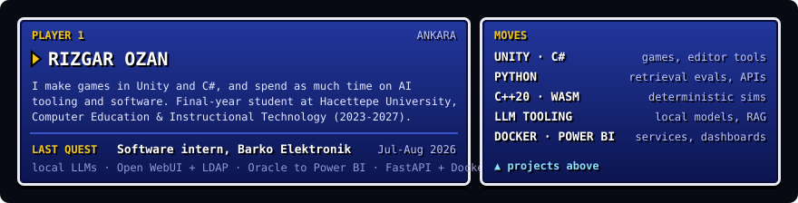

## Boss fight: Autobots vs Megatron

Everyone who visits plays the same fight. Click a move and it's played on the spot: Megatron answers, the scene below is redrawn, and you land back here. If the picture looks unchanged, give it a few seconds and refresh.

<!-- boss:start -->
**BUMBLEBEE's turn** · round 1 · wave 1/3: Megatron 6200/6200. Pick a move ↓

| Move | Cost | Effect |
|---|---|---|
| [**ATTACK**](https://profile-boss.rizgarozan7.workers.dev/move?h=bumblebee&m=atk&k=0) | – | STINGER: hit for 150–200 |
| [**SCOUT**](https://profile-boss.rizgarozan7.workers.dev/move?h=bumblebee&m=skill1&k=0) | 8 EP | Reveal his next move, party takes 40% less this round |
| [**ENERGON SHARE**](https://profile-boss.rizgarozan7.workers.dev/move?h=bumblebee&m=skill2&k=0) | 14 EP | Heal every hero +240 HP |
| [**GUARD**](https://profile-boss.rizgarozan7.workers.dev/move?h=bumblebee&m=guard&k=0) | – | Take ½ damage this round, +8 EP |
| LIMIT: STING OPERATION | 0% | Locked, fills as you attack and take hits |

Move links not opening on your network? [Play it as an issue](https://github.com/RizgarOzan/RizgarOzan/issues/new?title=boss%3A%20bumblebee%20atk&body=Change%20atk%20to%20skill1%2C%20skill2%2C%20guard%20or%20limit%20for%20another%20move%2C%20then%20press%20Submit.%20A%20GitHub%20Action%20plays%20it%20and%20updates%20the%20README%20in%20about%20a%20minute.) instead.

**Last moves**
- @RizgarOzan started a new fight.

<!-- boss:end -->

Each round the heroes go in order (Bumblebee, Grimlock, Hot Rod), then Megatron answers. Below half HP Soundwave joins him. When he charges his cannon, GUARD halves the blast. If someone moved before you, the page tells you and you pick again from the fresh board.

<!-- summary:start -->
**159 pull requests merged** into 41 projects I don't own, among them mteb, kornia, unity-mcp and docling. 16 more in review.
<!-- summary:end -->

**19 LeetCode solutions** in Python and C#: [leetcode-solutions](https://github.com/RizgarOzan/leetcode-solutions)

**Projects**

- [Turkish RAG Eval](https://github.com/RizgarOzan/turkish-rag-eval): a Turkish retrieval benchmark, on PyPI and now an MTEB task
- [Lockstep Tactics](https://github.com/RizgarOzan/lockstep-tactics): C++20 tactics game that stays bit-identical on MSVC, clang and WebAssembly ([play it](https://rizgarozan.github.io/lockstep-tactics/))
- [TMP Glyph Audit](https://github.com/RizgarOzan/tmp-glyph-audit): Unity package that finds TextMeshPro text your fonts can't draw
- [Match3 Lab](https://github.com/RizgarOzan/match3-lab): C# match-3 rules core, Unity editor tools and a bot simulator

Graduating in June 2027, open to internships and new-grad roles in applied AI and game engineering.

[github.com/RizgarOzan](https://github.com/RizgarOzan) · [rizgarozan.github.io](https://rizgarozan.github.io) · [LinkedIn](https://www.linkedin.com/in/rizgarozan/) · [itch.io](https://rizgarozan.itch.io)
