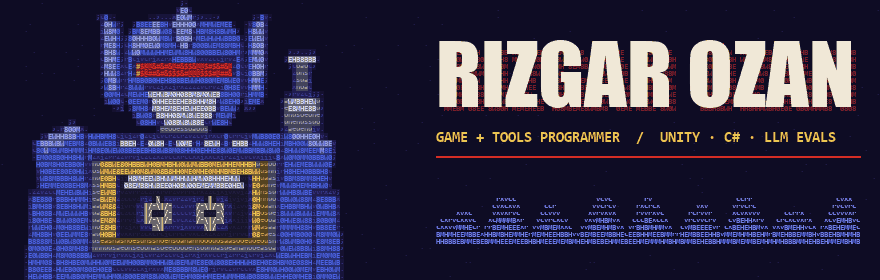
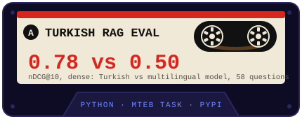
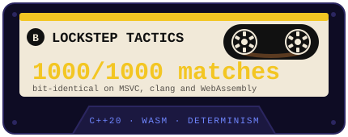
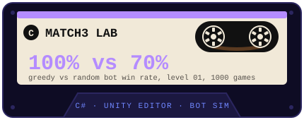
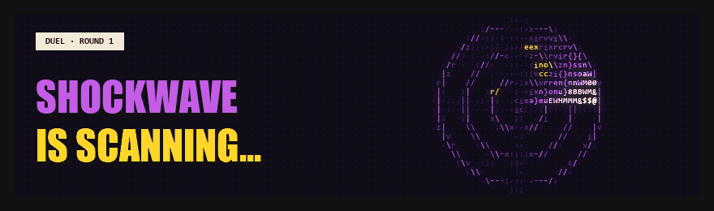

**Unity/C# game and tools programmer. I also build LLM eval tooling: [Turkish RAG Eval](https://github.com/RizgarOzan/turkish-rag-eval) is now an MTEB task.** 
Final year at Hacettepe University, graduating June 2027 · software intern at Barko Elektronik, Jul-Aug 2026 · looking for game/tools programmer and LLM-eval internships and new-grad roles in Europe and Turkey.

<!-- summary:start -->
**159 pull requests merged** into 41 projects I don't own, among them mteb, kornia, unity-mcp and docling. 16 more in review.
<!-- summary:end -->

`C#` `Unity` `C++20` `WebAssembly` `Python` `FastAPI` `Docker` `local LLMs / RAG`

[rizgarozan.github.io](https://rizgarozan.github.io) · [LinkedIn](https://www.linkedin.com/in/rizgarozan/) · [itch.io](https://rizgarozan.itch.io)

| Project | What it is | Proof |
|---|---|---|
| [Turkish RAG Eval](https://github.com/RizgarOzan/turkish-rag-eval) | Turkish retrieval benchmark, on PyPI and merged into MTEB | nDCG@10 0.78 for a Turkish model vs 0.50 for the default multilingual one, dense retrieval, 58 questions |
| [Lockstep Tactics](https://github.com/RizgarOzan/lockstep-tactics) | C++20 tactics game with a lockstep sim | 1000 of 1000 seeded matches bit-identical on MSVC, clang and WebAssembly · [play it](https://rizgarozan.github.io/lockstep-tactics/) |
| [Match3 Lab](https://github.com/RizgarOzan/match3-lab) | match-3 rules core, Unity editor tools, bot simulator | greedy bot wins 100% vs random 70% on level 01, 1000 games |
| [TMP Glyph Audit](https://github.com/RizgarOzan/tmp-glyph-audit) | Unity package that finds TextMeshPro text your fonts can't draw | 33 core tests |

**Barko Elektronik**, software intern, Jul-Aug 2026: local LLMs behind Open WebUI + LDAP, an Oracle to Power BI pipeline, FastAPI + Docker services.

## Duel: Soundwave vs Shockwave

Everyone who visits plays Soundwave in the same duel against Shockwave's planning AI. Turn engine and AI are in [game/](https://github.com/RizgarOzan/RizgarOzan/tree/main/game). Pick a move and a GitHub Action plays it in about a minute. If the picture looks unchanged, give it a few seconds and refresh.

<!-- boss:start -->
**Round 2** · Soundwave 2749/3000 HP, 30 EP · Shockwave 3502/3750. Pick Soundwave's move ↓

| Move | Cost | Effect |
|---|---|---|
| [**ATTACK**](https://github.com/RizgarOzan/RizgarOzan/issues/new?title=boss%3A%20soundwave%20atk&body=Just%20press%20Submit.%20A%20GitHub%20Action%20plays%20the%20move%20and%20updates%20the%20README%20in%20about%20a%20minute.) | – | SONIC BLASTER: hit for 200–260 |
| [**LASERBEAK**](https://github.com/RizgarOzan/RizgarOzan/issues/new?title=boss%3A%20soundwave%20skill1&body=Just%20press%20Submit.%20A%20GitHub%20Action%20plays%20the%20move%20and%20updates%20the%20README%20in%20about%20a%20minute.) | 14 EP | Hit twice for 110–140 each |
| [**MIND SCAN**](https://github.com/RizgarOzan/RizgarOzan/issues/new?title=boss%3A%20soundwave%20skill2&body=Just%20press%20Submit.%20A%20GitHub%20Action%20plays%20the%20move%20and%20updates%20the%20README%20in%20about%20a%20minute.) | 8 EP | Hit for 90–120, take half damage this round (even from CRUSHING GRIP), and see Shockwave's plan and reasoning for next round |
| [**GUARD**](https://github.com/RizgarOzan/RizgarOzan/issues/new?title=boss%3A%20soundwave%20guard&body=Just%20press%20Submit.%20A%20GitHub%20Action%20plays%20the%20move%20and%20updates%20the%20README%20in%20about%20a%20minute.) | – | Take a third of the damage this round, +10 EP, +15% limit. CRUSHING GRIP goes through it |
| LIMIT: CASSETTE ASSAULT | 24% | Locked, fills as you attack, guard and take hits |

Each move opens a prefilled issue: press **Submit** and a GitHub Action plays it, usually within a minute.

**Last moves**
- Shockwave uses ARM CANNON. 251 damage.
- @RizgarOzan · Laserbeak makes two passes: 136 and 112.
- Soundwave and Shockwave face off.

**Top damage this duel**: 🥇 @RizgarOzan 248
<!-- boss:end -->

How Shockwave thinks

Each round Soundwave moves, then Shockwave answers. Shockwave doesn't pick at random: he plans his next move from what you just did. Guard twice in a row and he crushes the guard, sit on full EP and he jams it, fall low and he goes for the finish, get him low and he repairs. MIND SCAN shows his next move and his reasoning. When he charges the LOGIC CANNON, GUARD or MIND SCAN. If someone moved before you, the page tells you and you pick again from the fresh board.

Letter art inspired by [@jin_22ee](https://github.com/JIN2-ASCII). Soundwave and Shockwave are Hasbro's Transformers; this is fan art.
